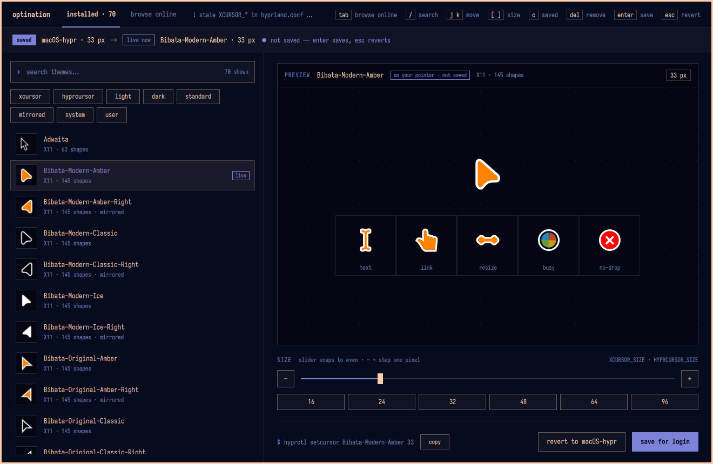

# optination

A cursor theme picker for Hyprland that shows you the cursors.

Choosing a cursor theme from a numbered list is guesswork — `Quintom_Ink` and
`Quintom_Snow` are just two words until you can see them. optination lists every
theme on the system with its actual pointer, I-beam, hand, resize, busy and
no-drop shapes rendered at the size you are about to use, applies your pick to
the live pointer the moment you click it, and only writes to disk when you say so.

It also browses the [pling / gnome-look](https://www.pling.com/browse?cat=107)
cursor catalog — about 1,200 themes — and installs any of them into
`~/.local/share/icons` with one key, putting the new theme straight on your
pointer to try.



## Install

Download the v0.3.0 release, check it against the published SHA-256, then run
its installer (x86-64 Linux):

```sh
curl -fLO https://github.com/lubabs770/optination/releases/download/v0.3.0/optination-linux-x86_64.tar.gz
echo "8cb013cdf6a6654f449ef2d0d38cc7b9c563d5dd83a0f5dc7fde4bc74f7a4e4d  optination-linux-x86_64.tar.gz" | sha256sum -c
tar xzf optination-linux-x86_64.tar.gz
./optination/install.sh
```

`sha256sum -c` stops with `FAILED` if the download is not the reviewed build;
don't run the installer then. Releases are
[immutable](https://docs.github.com/en/code-security/supply-chain-security/understanding-your-software-supply-chain/immutable-releases),
so this tag and its asset can't be replaced after publishing. With `gh`, you can
also check the file against GitHub's release attestation:
`gh release verify-asset v0.3.0 optination-linux-x86_64.tar.gz -R lubabs770/optination`.

That installs the `optination` binary to `~/.local/bin` and the overlay to
`~/.local/share/optination`, and on Omarchy links it in as the plugin
`io.github.lubabs770.optination` and enables it. Then run `optination`, or bind
it to a key (see [Build](#build)).

**Installed from the Omarchy plugin marketplace?** `omarchy plugin add` brings
the overlay only. Run the lines above as well to get the engine binary it
drives. The installer leaves a plugin folder it didn't create alone, so this
is safe.

**Removing:** `omarchy plugin remove io.github.lubabs770.optination`, then
`rm ~/.local/bin/optination` and `rm -r ~/.local/share/optination ~/.cache/optination`.
A saved cursor stays in the marked block in `~/.config/hypr/looknfeel.lua`
until you delete it.

## One overlay, two hosts

The picker is a single QML overlay (`qml/Picker.qml`) run by
[Quickshell](https://quickshell.org). Only the host around it differs:

| Where | Host | Colours |
|---|---|---|
| Omarchy | an overlay plugin inside the running `omarchy-shell` (`qml/omarchy/`) | the shell's live `[menu]` theme tokens — follows every theme switch |
| any other Hyprland | its own short-lived Quickshell instance (`qml/standalone/`) | Omarchy's `colors.toml` if present, otherwise built-in dark defaults |

`optination` with no arguments picks the right one and toggles it. Inside
Omarchy it never starts a second Quickshell — the plugin lives in the shell
that is already running. Outside it, the instance quits when the picker closes,
so nothing idles in the background.

The Rust binary is the engine behind both: it finds themes, renders their
shapes to PNGs under `$XDG_CACHE_HOME/optination/` (reused until a theme's
directory changes), and applies the choice. The overlay drives it through the
`--json` flags below.

## As an Omarchy plugin

Plugin id `io.github.lubabs770.optination`, kind `overlay`, entry point
`qml/Overlay.qml`; `manifest.json` sits at the repo root. The plugin is only
the UI — it drives the `optination` binary, found on `PATH` or in
`~/.local/bin`. If the binary is missing the picker opens with a message saying
so instead of an empty list.

```sh
./install.sh                                   # binary + QML, links and enables the plugin
omarchy-shell shell toggle io.github.lubabs770.optination
omarchy plugin remove io.github.lubabs770.optination   # unlinks; nothing else is touched
```

**What it writes:** nothing on open or while browsing except the live pointer
(`hyprctl setcursor`, `gsettings`). Installing from the catalog writes the
theme to `~/.local/share/icons` and stages downloads in
`$XDG_CACHE_HOME/optination/downloads` (cleared afterwards). **Save for login** (Enter) writes the marked block in
`looknfeel.lua` described under *Applying*. Its own files are a PNG cache in
`$XDG_CACHE_HOME/optination/` and the list width in
`$XDG_STATE_HOME/optination/ui.json`. It never edits keybindings or menu
extensions.

**Trust boundary:** everything read from the engine is size-capped and
shape-checked before use, images load only from its own cache directory (or, in the browse tab, pling's https image host), all
text renders as plain text, and every command runs as an argument vector — no
shell strings built from theme names.

**Closing:** Esc, a click outside the card, or `optination` again. Like
Omarchy's own overlays it does not respond to Super+W: Hyprland handles that
bind as *close window* before the overlay sees the key.

## Saved vs. live

Browsing changes the pointer as you go, which used to make it easy to lose
track of what you started with. A strip under the header always shows both:

- **saved** — what the next login gets (the managed block in `looknfeel.lua`)
- **live now** — what is on the pointer at this moment, marked *not saved*
  when it differs

List rows carry the same `saved` / `live` badges, the preview names the state
of the theme you are looking at, `c` jumps back to the saved theme, and the
buttons say what they will do (`revert to macOS-hypr`, `save for login`).

## Keys

| Key | Installed tab | Browse tab |
|---|---|---|
| Tab | switch to browse | switch to installed |
| `/` | search installed themes | search the catalog |
| `j` `k` / `↓` `↑` | move; the pointer under your hand follows | move |
| `h` `l` / `←` `→` | — | flip through preview pictures |
| `[` `]` | size −1 / +1 px | — |
| `c` | jump back to the saved theme | — |
| Del | remove a theme from your home folder (press twice) | — |
| `o` | — | open the item on pling.com |
| Enter | save for login | install the recommended variant, or try it if installed |
| Esc | revert to what was active when it opened, and close | same |

The slider snaps to even sizes and the size buttons jump; `−` `+` and `[` `]`
move a single pixel, so an odd size is reachable. The theme list's width is
draggable and remembered in `$XDG_STATE_HOME/optination/ui.json`.

## Browsing and installing

The **browse online** tab reads the OpenDesktop OCS API (category 107,
*Cursors* — the same catalog gnome-look.org and KDE's "Get New Cursors"
use). Search, sort by downloads / rating / newest / name, scroll for more.
Each item lists the downloads that can be a Linux cursor theme; Windows,
macOS (`.cape`) and image-only bundles are hidden and counted. The
recommended variant is the plain tarball (`Nordzy-cursors.tar.gz` over
`Nordzy-cursors-lefthand.tar.gz`), and Enter installs it.

An installed theme goes on the pointer immediately, unsaved — Enter saves it,
Esc puts back what you had. Items already on disk are badged *installed*,
whether optination installed them or you did.

Installing handles untrusted archives, so it is strict:

- downloads go through `curl`, **https only** (redirects too), with
  `~/.curlrc` ignored, capped at 200 MB and timed out; when the catalog
  lists an md5 the file must match it — that catches a corrupt or truncated
  download, not a malicious one, since the sum comes from the same catalog;
- the archive is listed before unpacking and refused past 40,000 entries or
  600 MB unpacked;
- `bsdtar` unpacks it into an empty, owner-only staging folder, with its
  default refusal of `..` and absolute paths left on, and without owners,
  ACLs or xattrs;
- only folders that are cursor themes are kept, and only if everything in
  them is a plain file, a folder, or a symlink that stays inside the theme;
- every installed file is made `0644` and every folder `0755`, so nothing a
  theme ships is left executable, and nothing from the archive is ever run;
- the theme name must pass the same check `--save` applies;
- an existing theme of the same name is never overwritten unless optination
  installed it (it leaves `.optination-source.json` in the themes it installs).

Cursor themes are data — Xcursor images, SVGs, PNGs and an `index.theme` —
and optination only ever reads them. What you install is still third-party
content from the catalog, which optination does not vet; the browse tab is
there so you can look before you install.

Preview pictures load only from `https://images.pling.com/`, fetched by the
shell itself (Qt's image loader), so browsing makes network requests from
the shell process; the installed tab makes none. Remove a theme
with Del in the installed tab or `optination --remove`; system themes and the
saved theme are refused.

## Why

It replaces a shell function that had two problems beyond being blind:

- **It could only see half the themes.** It globbed for `*/cursors/`, which is
  the Xcursor layout. Every hyprcursor theme — `manifest.hl` plus
  `hyprcursors/*.hlc` — was invisible to it. On the machine it was written for
  that was 16 of 69 themes.
- **Its "make permanent" wrote to a file nothing reads.** It appended
  `env = XCURSOR_THEME,…` to `~/.config/hypr/hyprland.conf`, which Omarchy 4
  stopped reading when the Hyprland config moved to Lua. The setting looked
  saved and silently was not.

## What it handles

| Format | Layout | Assets |
|---|---|---|
| Xcursor | `<theme>/cursors/<shape>` | binary, pre-rasterized ARGB at fixed sizes |
| hyprcursor | `<theme>/manifest.{hl,toml}` + `<theme>/hyprcursors/<shape>.hlc` | zip of `meta.hl` + SVG **or** PNG |

Both manifest dialects and both hyprcursor asset kinds are real and in the wild;
a picker that only handles `manifest.hl` or only handles SVG will quietly drop
themes.

## Filtering

A search box over name, comment, format and tone, plus chips:

| Group | Chips | Derived from |
|---|---|---|
| Format | `X11`, `hyprcursor` | which directories the theme ships |
| Tone | `light`, `dark` | a `light`/`white`/`dark` word in the theme name |
| Handedness | `standard`, `mirrored` | a `right`/`lefthand` word in the theme name |
| Source | `system`, `user` | `/usr/share/icons` vs. under `$HOME` |

Chips within a group are OR-ed and the groups are AND-ed, so `hyprcursor` + `dark`
narrows to dark hyprcursor themes instead of producing the empty set. A group with
nothing checked places no constraint.

Tone and handedness are read off the theme *name*, which is the only place the
information is recorded — a theme that declares neither stays untagged rather than
being guessed at from its pixels.

## Missing shapes

Not every theme defines every shape. Where one is absent the preview cell shows a
dash rather than an unexplained hole, and `--check` lists it:

```
$ optination --check 32
rose-pine-hyprcursor                     missing: busy
1 theme(s) with an undrawable preview slot at 32px
```

That is a gap in the *theme* — Hyprland will fall back to another theme's shape at
runtime — and this is how you find out before committing to it. A shape that
decodes but rasterizes to fully transparent pixels counts as missing too, since on
screen the two are the same thing.

## Applying

Three consumers need telling, and none of them covers the others:

| Mechanism | Reaches | Lifetime |
|---|---|---|
| `hyprctl setcursor` | Hyprland's own pointer | immediate, until reload |
| `gsettings set org.gnome.desktop.interface cursor-theme` | GTK apps, settings portal | the session |
| `hl.env("XCURSOR_THEME", …)` in `~/.config/hypr/looknfeel.lua` | every client's environment | permanent |

Clicking a theme does the first two, so the pointer under your hand changes while
you browse. **Save for login** (Enter) adds the third, writing a marked block:

```lua
-- >>> optination (managed block) >>>
hl.env("XCURSOR_THEME", "Bibata-Modern-Ice")
hl.env("XCURSOR_SIZE", "30")
hl.env("HYPRCURSOR_THEME", "Bibata-Modern-Ice")
hl.env("HYPRCURSOR_SIZE", "30")
-- <<< optination (managed block) <<<
```

Rewritten in place on each save, never duplicated, with a timestamped backup of
the file alongside it. `looknfeel.lua` is a user file that Omarchy loads after
its own defaults, so the `XCURSOR_SIZE` in `default/hypr/envs.lua` is overridden
rather than fought with. After writing, `hyprctl reload` and
`hyprctl configerrors` run, and a config error is reported instead of waiting to
bite at next login.

**Revert** (or Esc, or clicking outside the card) puts back whatever was set when
the picker opened, so trying things on live is free.

## CLI

The thing this replaced was a shell function, and shell functions get called
from scripts.

```
optination                          open (or close) the picker overlay
optination --list                   every theme found: name, format, shape count
optination --check [SIZE]           report which preview shapes a theme cannot draw
optination --apply <THEME> [SIZE]   apply for this session
optination --save  <THEME> [SIZE]   apply and persist
optination --current                print the active theme and size
optination --render <THEME> <SIZE>  render the six preview shapes to the cache
optination --thumbs                 render every theme's list thumbnail to the cache
optination --stale                  report a stale XCURSOR_* line in hyprland.conf
optination --store [QUERY] [--page N] [--sort downloads|rating|new|name]
                                    search the online catalog
optination --install <ID> [FILE]    install catalog item ID (default: its recommended file)
optination --remove <THEME>         delete a theme installed under your home
```

`--current` prints what is live and what is saved. Add `--json` to `--list`,
`--current`, `--render`, `--thumbs`, `--stale`, `--store` or `--install` for
the machine format the overlay reads.

`--check` reports gaps in the *themes*, not in optination — a theme with no
`wait`/`watch` shape will fall back to another theme's at runtime, and this is
how you find that out before you commit to it.

## Build

CI builds every push and uploads the `optination-linux-x86_64` bundle: the
binary, `manifest.json`, `qml/`, `share/` and `install.sh`. Pushing a `v*` tag
also publishes that bundle as an immutable GitHub release. The
[Install](#install) lines pin one release by tag and SHA-256; a new release
updates both in the README.

From a checkout, build with `cargo build --release`, then run `./install.sh`,
which picks up `target/release/optination`. It puts the binary in
`~/.local/bin`, the plugin folder in `~/.local/share/optination`, and the desktop
entry and icon where the launcher finds them.

To open it from a key, bind `optination` — e.g. in `~/.config/hypr/bindings.lua`
on Omarchy — or add a row to `~/.config/omarchy/extensions/omarchy-menu.jsonc`:

```jsonc
"style.cursor": {"icon":"󰇀","label":"Cursor","action":"optination"}
```

Runtime needs: Quickshell (Omarchy ships it; elsewhere `pacman -S quickshell`),
`hyprctl`, `gsettings`, `wl-copy` for the copy button, and `curl` + `bsdtar`
(libarchive) for the browse tab. Xcursor parsing via
`xcursor`, SVG via `resvg`, PNG via `png`, hyprcursor archives via `zip`.

## Notes

- Cursors are drawn at their true pixel size — the preview is the thing itself,
  not an approximation of it.
- For themes shipping both formats, the hyprcursor version is previewed, since
  that is the one Hyprland will actually use.

## License

MIT.
